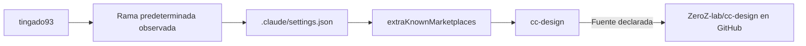
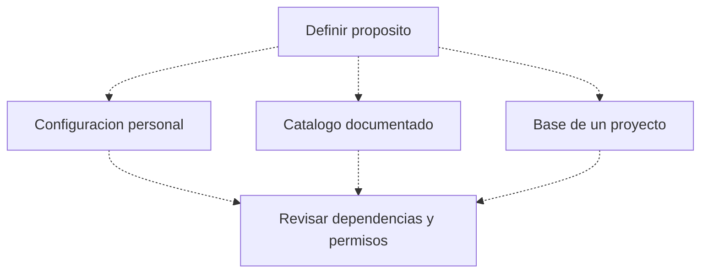

# Mapa del repositorio — tingado93

[Volver al README](../README.md) · [Revisión](REVISION.md)

## Grafo de la configuración existente

**Lectura:** el único archivo original encontrado declara un marketplace externo. No se descargó ni ejecutó su contenido. No se comprobaron instalación de plugins, permisos, compatibilidad ni disponibilidad del servicio.

## Estructura y alcance

| Elemento | Qué demuestra | Qué no demuestra |
|---|---|---|
| `.claude/settings.json` | Existe una referencia a un origen GitHub. | Que sus componentes estén instalados o aprobados. |
| Rama `claude/add-zeroZ-lab-skills-4nh8R` | Es la predeterminada observada durante la revisión. | Que las demás ramas tengan el mismo contenido. |
| Ausencia de app en la raíz revisada | No se identificó un ejecutable en ese inventario. | Que nunca haya existido código en el historial. |

## Propuesta de uso — decisión pendiente

No se elige una de esas alternativas ni se renombra la rama por cuenta del usuario.

## Procedimiento de revisión recomendado

1. Confirmar el propósito del repositorio.
2. Revisar la documentación y procedencia del marketplace externo antes de activarlo.
3. Contrastar permisos y restricciones en el entorno donde vaya a usarse.
4. Probar con datos ficticios y sin secretos.
5. Documentar componentes instalados y resultados reales, sin confundir una referencia con una instalación.

La configuración original permanece intacta. No se añadieron instrucciones operativas de agentes, no se instalaron habilidades y no se ejecutó código externo.
